# StudySlot — Assignment 2: HTTP APIs, gRPC, and Metrics

Enterprise Software Development, Fall 2026 · Widad Fatima Khan

StudySlot is the campus study-room booking service from Assignment 1. This
assignment extends it: Part A improves the HTTP API, Part B adds a gRPC version
of one operation, and Part C extends the metrics. Run and test commands are in
the [README](README.md). The Assignment 1 report is in [docs/a1/REPORT.md](docs/a1/REPORT.md).

---

## Part A — Improve the HTTP API

### A.1 REST constraints

| # | Constraint | What it means | StudySlot example |
|---|---|---|---|
| 1 | Client–server | Callers and the server are separate and only share the API contract, so each side can change on its own. | Swagger UI, `scripts/booking_caller.py` and the gRPC client never touch the database. In this assignment bookings moved from an in-memory dict to SQLite without any caller noticing. |
| 2 | Stateless | Every request carries everything the server needs; the server keeps no per-client session between requests. | `POST /bookings` carries the whole booking plus its `Idempotency-Key` and `X-Request-ID`; there is no login or session. *Caveat:* the rate limiter keeps each client IP's recent call times in memory. That is throttling bookkeeping rather than session context, and with several API instances it would move to a shared store such as Redis. |
| 3 | Cacheable | Responses say whether, and for how long, they may be reused. | **Not demonstrated.** Responses carry no `Cache-Control` or `ETag` headers. Availability changes with every booking, so we chose not to cache it. `GET /bookings/{id}` would be a good candidate for an `ETag`, because a booking never changes after it is created. |
| 4 | Layered system | A client cannot tell whether it talks to the server directly or through intermediaries. | Docker's port forwarding sits between the laptop and the container: callers just use `localhost:8000`, while the server sees every caller as `172.20.0.1`, the Docker gateway (visible in the 429 body). A load balancer or API gateway could be added in front without changing any caller. |
| 5 | Uniform interface | Every resource follows the same rules: nouns in URLs, standard methods, self-describing messages and links. | Resources `/bookings` and `/bookings/{id}`; GET, POST, PUT and DELETE used with their standard meanings; JSON representations; self-describing status codes and headers (`Content-Type`, `Location`, `Retry-After`, `Idempotent-Replayed`); one error format. HATEOAS only partly: the `Location` header links to the new booking, but response bodies carry no links (Richardson level 2). |
| 6 | Code on demand *(optional)* | The server may send code that the client runs. | Only in a small way: `/docs` and `/redoc` return pages whose JavaScript (Swagger UI, ReDoc) turns the browser into an API console. The JSON endpoints themselves send no code. |

### A.2 Endpoint review

The chosen **user task** is *a student books a study room*.

**Before/after for the user task**

| Old endpoint | Problem | Change | Reason |
|---|---|---|---|
| `POST /book` | Verb in the path; the path does not name a resource. | `POST /bookings` | The path names the collection; the method says "create one". |
| `POST /book` → `200` | No booking ID and no link, so a caller could not fetch or cancel *its* booking. | `201 Created` with `Location: /bookings/{id}` and the booking (with `id`) in the body. | 201 says something new exists, and `Location` says where. |
| `POST /book` errors | Every rule broken gave `400`, some details were plain strings and others objects. | One error format for every endpoint (below); `422` for readable-but-invalid input, `400` only for malformed JSON, `409` for a taken room. | Callers can handle every error with the same code path, and the status says what kind of problem it is. |
| `POST /book` input | Duplicate or blank student IDs and unknown fields were silently accepted. | Request model rejects unknown fields; student IDs must be 1–50 unique values of 1–32 letters, digits, `-` or `_`. The same rules live in `booking_core.py`, which gRPC reuses. | Bad data never reaches storage, and both APIs enforce identical rules. |
| `POST /book` retries | A retry after a lost response got `409`, so the caller could not tell whether its own booking had worked. | Optional `Idempotency-Key` header (A.4). | Retries are safe and get the original booking back. |
| `POST /book` storage | Bookings lived in a Python dict: lost on restart and impossible to share with a second service. | SQLite file on a Docker volume, with `UNIQUE(room, slot)`. | Survives restarts, and Part B's gRPC container can share it. |

**Error format** (every error response):

```json
{"error": {"code": "double_booked",
           "message": "Room R3 is already booked for 09:00.",
           "request_id": "005855fb926846bf",
           "details": {}}}
```

`request_id` matches the `X-Request-ID` response header and the log lines for that request.

**Other endpoints**

| Before (A1) | After (A2) | Changed? |
|---|---|---|
| `DELETE /bookings/{room}/{slot}` → `200` | `DELETE /bookings/{id}` → `204`; `404` if it does not exist | Changed: bookings are addressed by their ID. |
| — | `GET /bookings/{id}` → `200` / `404` | Added: the `Location` header must point at something real. |
| `GET /availability` | Same path; `group_size` must be 1–50; unknown slot → `422`; rate limited (A.5) | Changed (validation, rate limit). |
| `POST /chaos/delay?seconds=` | `PUT /chaos/delay` with body `{"seconds": 0–10}` | Changed: PUT sets a value, so repeating it is harmless; the value is validated. |
| `POST /chaos/cardinality?active=` | `PUT /chaos/cardinality` with body `{"active": true}` | Changed, same reason. |
| `GET /chaos/status` | `GET /chaos` (all switches) | Changed. |
| — | `PUT /chaos/failures` with body `{"count": N}` | Added: the next N bookings fail with 503, for the caller demo. |
| `GET /rooms`, `GET /bookings`, `GET /` | Same paths; response shapes now documented | Left alone: already clear and correct. |
| `GET /health`, `GET /metrics` | — | Out of scope (unchanged). |

**Callers updated:** the README's usage and experiment instructions now use the
new paths. The new callers (`booking_caller.py`, `rate_limit_demo.py`, the
tests) were written against the new API. The Assignment 1 report was left as a
historical record.

**Tests: valid, invalid, repeated.** Through Swagger UI:

| Case | Result | Evidence |
|---|---|---|
| Valid booking | `201`, `Location` header, booking with `id` | 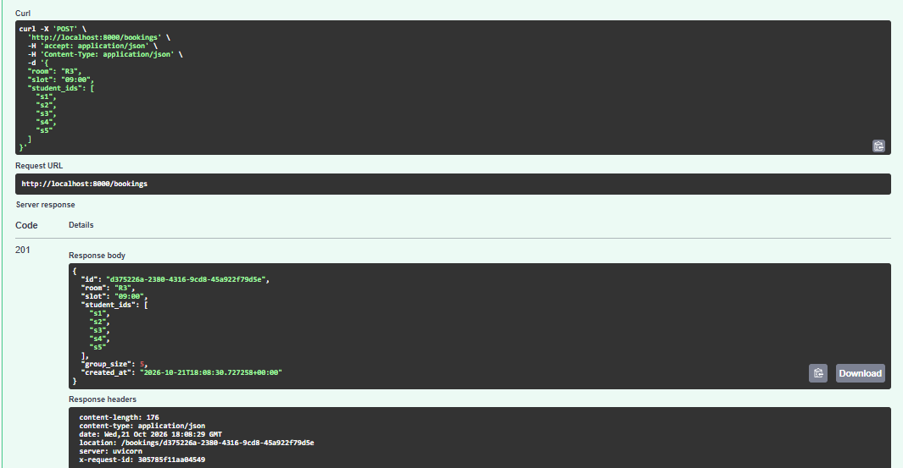 |
| Repeated booking (no key) | `409 double_booked`, nothing duplicated | 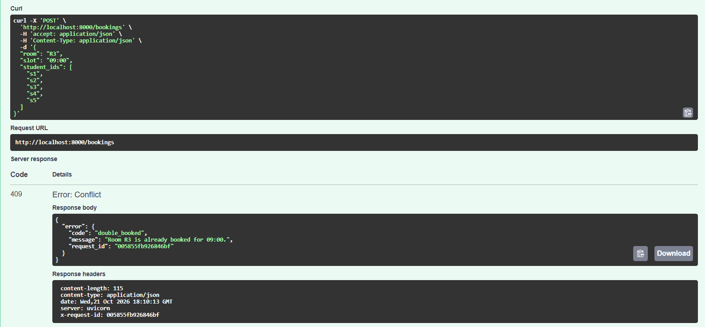 |
| Duplicate student IDs | `422 invalid_student_ids` | 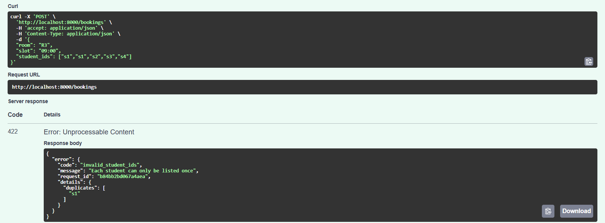 |
| Unknown slot | `422 unknown_slot` | 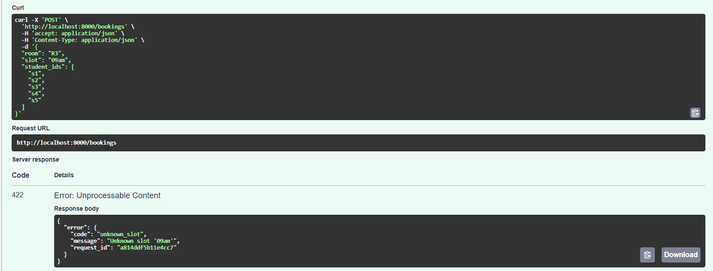 |
| Malformed JSON | `400 malformed_json` | 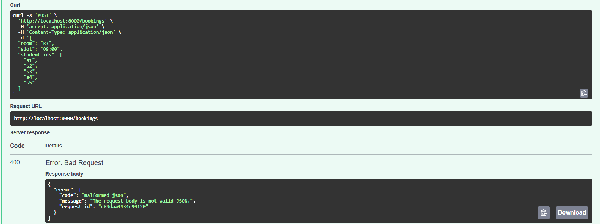 |
| Get / cancel / cancel again | `200`, `204`, `404 not_found` | 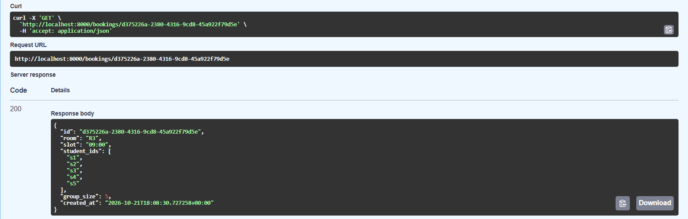 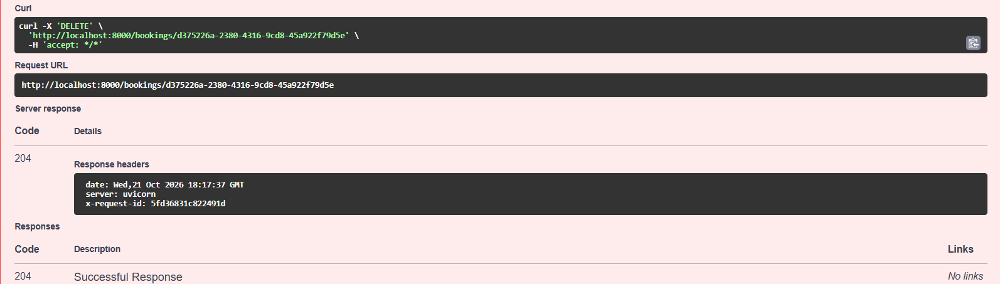 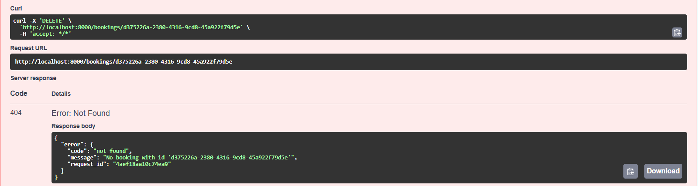 |

The same cases, plus idempotency, rate limiting and the error format, are
automated in `tests/test_api.py` (`.venv\Scripts\python -m pytest -v`):

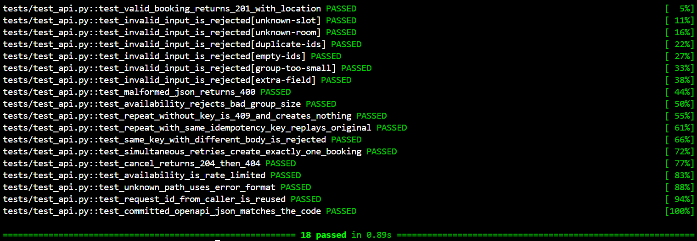

### A.3 OpenAPI Specification

OpenAPI is a standard, machine-readable format (JSON or YAML) for describing an
HTTP API: its paths, methods, parameters, request bodies, and every response
with its status code and schema. It works as a contract between a service and
its callers. People read it as documentation, and tools use it to generate
interactive docs, client code and test requests, or to check that real traffic
matches the contract.

FastAPI generates the spec from the code, so it cannot drift from the routes.
It is exported to [`openapi.json`](openapi.json) (`python scripts/export_openapi.py`),
and a test fails if the committed file stops matching the code. The spec
documents every route, its inputs (body schema with constraints, query and path
parameters, the `Idempotency-Key` header) and every success and error response,
including response headers (`Location`, `Idempotent-Replayed`, `Retry-After`,
`X-RateLimit-*`).

**How it was used:** ReDoc, generated from the spec, to inspect the
`POST /bookings` contract; and Swagger UI, which builds and validates requests
from the spec, to test the endpoints. All of A.2's screenshots were made
through it, and Swagger refused to send a non-UUID booking ID because the spec
declares `format: uuid`.

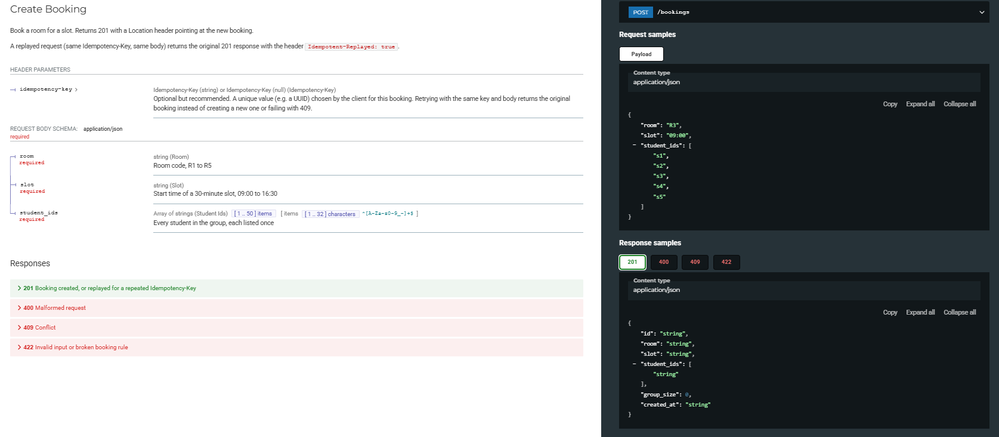
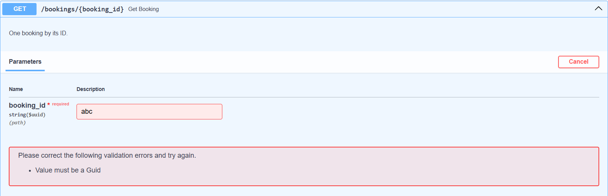

### A.4 Idempotency (safe repeats)

`POST /bookings` is the one operation where repeating means "create another",
so it may be retried only if duplicates are impossible. The client sends an
`Idempotency-Key` header, a unique value per booking (e.g. a UUID), and reuses
it on every retry:

- **Same key, same body:** the original `201` and booking come back with
  `Idempotent-Replayed: true`; nothing new is created and the bookings counter
  is not incremented.
- **Same key, different body:** `422 idempotency_key_reused`.
- **No key:** the database's `UNIQUE(room, slot)` still prevents a duplicate (`409`).

The key check and the insert run in **one database transaction that takes the
write lock first**, so simultaneous retries, even through different APIs, cannot
both create a booking (tested with 10 parallel retries: one booking, nine
replays). Keys are kept for 24 hours.

The other operations are safe to repeat without a key: `GET` only reads; `PUT`
sets a value, and setting it twice leaves the same state; a repeated `DELETE`
returns `404` but changes nothing further.

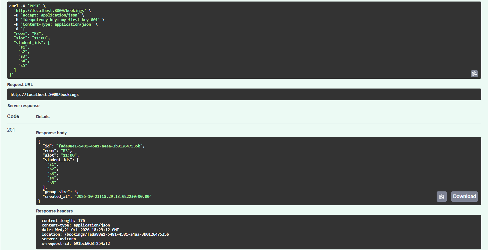
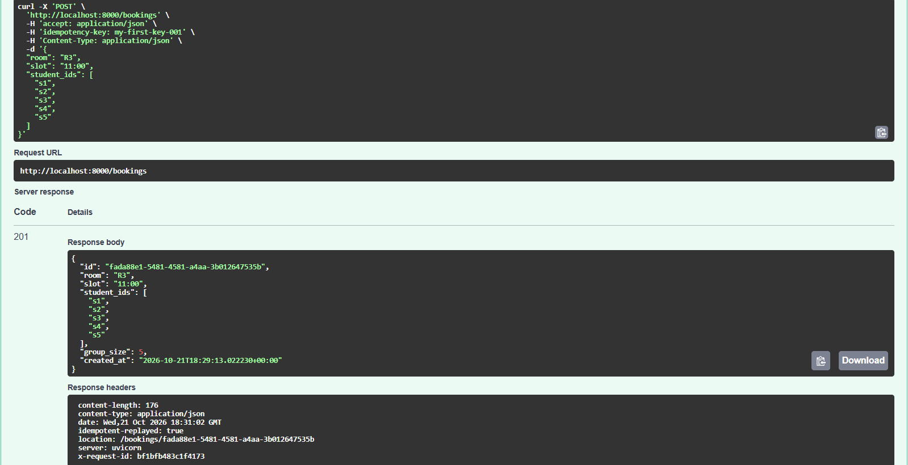
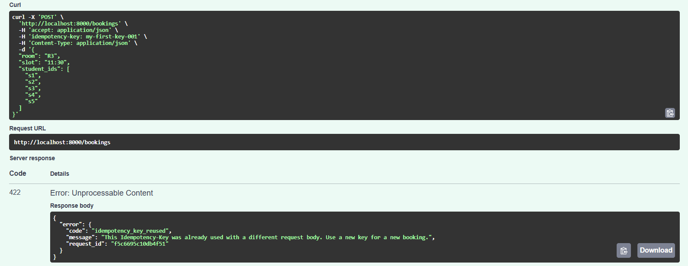

### A.5 Rate limiting

| | |
|---|---|
| **Endpoint** | `GET /availability`: students poll it while hunting for a free room, so it is the call most likely to be hammered. Limiting it never blocks an actual booking. |
| **Limit** | 5 calls in any 10-second period (sliding window). |
| **Who shares it** | All requests from the same client IP address. Through Docker Desktop every caller on the laptop reaches the container from the gateway address `172.20.0.1`, so they share one budget. |
| **When calls are allowed again** | The `429 Too Many Requests` response carries `Retry-After: N`, the seconds until the oldest of the 5 calls leaves the window. Every response also carries `X-RateLimit-Limit` and `X-RateLimit-Remaining`. |
| **Limitation** | Counts live in the API process's memory (single instance): they reset on restart and would not be shared between several API instances, which would need a shared atomic store such as Redis. |

Output of `python scripts/rate_limit_demo.py`: five accepted calls, then `429`
with `Retry-After`, then acceptance again after waiting. The last call shows
`Remaining=2` because the window slides: calls 2–5 expire one by one, 10 s after
each was made.

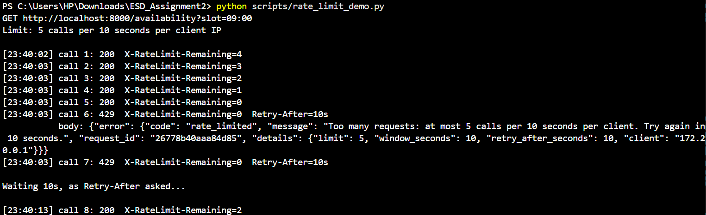

### A.6 Python caller

`scripts/booking_caller.py` acts as another service booking rooms through
`POST /bookings`. One run makes several calls and uses the API's chaos switches
to cause failures on purpose.

| Setting | Value |
|---|---|
| Timeout | 1.0 s per attempt |
| Retry limit | 3 attempts in total (1 + 2 retries) |
| Backoff | 0.25 s, then 0.5 s (doubling), ±20 % random jitter |
| Retried | Timeouts, connection errors and 5xx only; never 4xx |
| Why retrying a POST is safe | Every logical booking has one `Idempotency-Key`, reused by all its retries (A.4) |
| Circuit breaker | Opens after 3 failed attempts in a row; blocks calls without contacting the server for 5 s; then lets one trial call through (half-open), closing on success or reopening on failure |

What the output shows:

1. **Succeeding:** two bookings succeed on the first attempt.
2. **Retrying a failure:** with one injected `503`, attempt 1 fails and attempt 2 succeeds.
3. **Blocking while open:** with a 2 s server delay and a 1 s timeout, three attempts time out, the breaker opens, and the next two calls are blocked instantly.
4. **Recovering:** after the delay is removed and 5 s pass, the half-open trial succeeds and the breaker closes.
5. **Bonus:** retrying step 3's "failed" booking with the same key returns `REPLAYED`. The server had finished the booking after the client timed out, and the key stopped a double booking.

Rate limiting is demonstrated separately (A.5); the caller never calls the rate-limited endpoint.

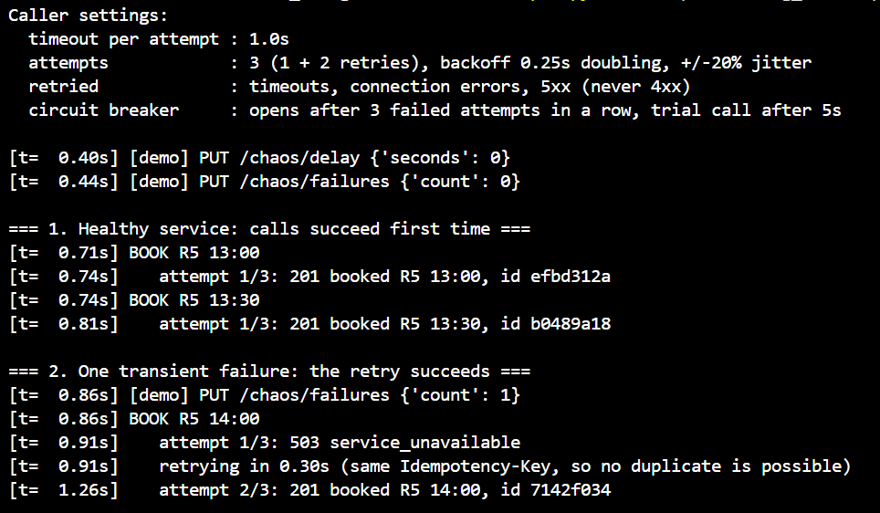
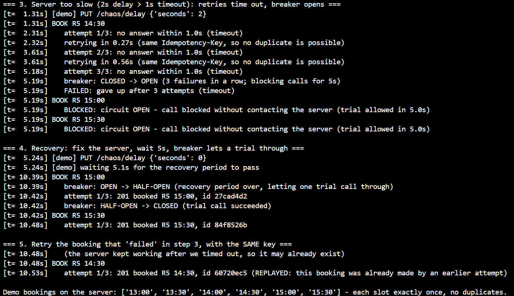

---

## Part B — gRPC service

*To be completed.*

---

## Part C — Metrics

*To be completed.*

---

## References and reused work

- Course lecture notes, *APIs: From Local Function Calls to RESTful HTTP Services* (REST constraints, method semantics).
- Course gRPC workshop (Week 1, Midnight Launch) used as a reference for Part B.
- Assignment 1 (StudySlot) code, extended in this assignment.