# StudySlot — Assignment 2: HTTP APIs, gRPC, and Metrics

Enterprise Software Development, Fall 2026 · Widad Fatima Khan

StudySlot is the campus study-room booking service from Assignment 1. This
assignment extends it: Part A improves the HTTP API, Part B adds a gRPC version
of one operation, and Part C extends the metrics. Run and test commands are in
the [README](README.md). The Assignment 1 report is in [docs/a1/REPORT.md](docs/a1/REPORT.md).

---

## Part A — Improve the HTTP API

### A.1 REST constraints

| # | Constraint | What it means | StudySlot example |
|---|---|---|---|
| 1 | Client–server | Callers and the server are separate and only share the API contract, so each side can change on its own. | Swagger UI, `scripts/booking_caller.py` and the gRPC client never touch the database. In this assignment bookings moved from an in-memory dict to SQLite without any caller noticing. |
| 2 | Stateless | Every request carries everything the server needs; the server keeps no per-client session between requests. | `POST /bookings` carries the whole booking plus its `Idempotency-Key` and `X-Request-ID`; there is no login or session. *Caveat:* the rate limiter keeps each client IP's recent call times in memory. That is throttling bookkeeping rather than session context, and with several API instances it would move to a shared store such as Redis. |
| 3 | Cacheable | Responses say whether, and for how long, they may be reused. | **Not demonstrated.** Responses carry no `Cache-Control` or `ETag` headers. Availability changes with every booking, so we chose not to cache it. `GET /bookings/{id}` would be a good candidate for an `ETag`, because a booking never changes after it is created. |
| 4 | Layered system | A client cannot tell whether it talks to the server directly or through intermediaries. | Docker's port forwarding sits between the laptop and the container: callers just use `localhost:8000`, while the server sees every caller as `172.20.0.1`, the Docker gateway (visible in the 429 body). A load balancer or API gateway could be added in front without changing any caller. |
| 5 | Uniform interface | Every resource follows the same rules: nouns in URLs, standard methods, self-describing messages and links. | Resources `/bookings` and `/bookings/{id}`; GET, POST, PUT and DELETE used with their standard meanings; JSON representations; self-describing status codes and headers (`Content-Type`, `Location`, `Retry-After`, `Idempotent-Replayed`); one error format. HATEOAS only partly: the `Location` header links to the new booking, but response bodies carry no links (Richardson level 2). |
| 6 | Code on demand *(optional)* | The server may send code that the client runs. | Only in a small way: `/docs` and `/redoc` return pages whose JavaScript (Swagger UI, ReDoc) turns the browser into an API console. The JSON endpoints themselves send no code. |

### A.2 Endpoint review

The chosen **user task** is *a student books a study room*.

**Before/after for the user task**

| Old endpoint | Problem | Change | Reason |
|---|---|---|---|
| `POST /book` | Verb in the path; the path does not name a resource. | `POST /bookings` | The path names the collection; the method says "create one". |
| `POST /book` → `200` | No booking ID and no link, so a caller could not fetch or cancel *its* booking. | `201 Created` with `Location: /bookings/{id}` and the booking (with `id`) in the body. | 201 says something new exists, and `Location` says where. |
| `POST /book` errors | Every rule broken gave `400`, some details were plain strings and others objects. | One error format for every endpoint (below); `422` for readable-but-invalid input, `400` only for malformed JSON, `409` for a taken room. | Callers can handle every error with the same code path, and the status says what kind of problem it is. |
| `POST /book` input | Duplicate or blank student IDs and unknown fields were silently accepted. | Request model rejects unknown fields; student IDs must be 1–50 unique values of 1–32 letters, digits, `-` or `_`. The same rules live in `booking_core.py`, which gRPC reuses. | Bad data never reaches storage, and both APIs enforce identical rules. |
| `POST /book` retries | A retry after a lost response got `409`, so the caller could not tell whether its own booking had worked. | Optional `Idempotency-Key` header (A.4). | Retries are safe and get the original booking back. |
| `POST /book` storage | Bookings lived in a Python dict: lost on restart and impossible to share with a second service. | SQLite file on a Docker volume, with `UNIQUE(room, slot)`. | Survives restarts, and Part B's gRPC container can share it. |

**Error format** (every error response):

```json
{"error": {"code": "double_booked",
           "message": "Room R3 is already booked for 09:00.",
           "request_id": "005855fb926846bf",
           "details": {}}}
```

`request_id` matches the `X-Request-ID` response header and the log lines for that request.

**Other endpoints**

| Before (A1) | After (A2) | Changed? |
|---|---|---|
| `DELETE /bookings/{room}/{slot}` → `200` | `DELETE /bookings/{id}` → `204`; `404` if it does not exist | Changed: bookings are addressed by their ID. |
| — | `GET /bookings/{id}` → `200` / `404` | Added: the `Location` header must point at something real. |
| `GET /availability` | Same path; `group_size` must be 1–50; unknown slot → `422`; rate limited (A.5) | Changed (validation, rate limit). |
| `POST /chaos/delay?seconds=` | `PUT /chaos/delay` with body `{"seconds": 0–10}` | Changed: PUT sets a value, so repeating it is harmless; the value is validated. |
| `POST /chaos/cardinality?active=` | `PUT /chaos/cardinality` with body `{"active": true}` | Changed, same reason. |
| `GET /chaos/status` | `GET /chaos` (all switches) | Changed. |
| — | `PUT /chaos/failures` with body `{"count": N}` | Added: the next N bookings fail with 503, for the caller demo. |
| `GET /rooms`, `GET /bookings`, `GET /` | Same paths; response shapes now documented | Left alone: already clear and correct. |
| `GET /health`, `GET /metrics` | — | Out of scope (unchanged). |

**Callers updated:** the README's usage and experiment instructions now use the
new paths. The new callers (`booking_caller.py`, `rate_limit_demo.py`, the
tests) were written against the new API. The Assignment 1 report was left as a
historical record.

**Tests: valid, invalid, repeated.** Through Swagger UI:

| Case | Result | Evidence |
|---|---|---|
| Valid booking | `201`, `Location` header, booking with `id` |  |
| Repeated booking (no key) | `409 double_booked`, nothing duplicated |  |
| Duplicate student IDs | `422 invalid_student_ids` |  |
| Unknown slot | `422 unknown_slot` |  |
| Malformed JSON | `400 malformed_json` |  |
| Get / cancel / cancel again | `200`, `204`, `404 not_found` |    |

The same cases, plus idempotency, rate limiting and the error format, are
automated in `tests/test_api.py` (`.venv\Scripts\python -m pytest -v`):


### A.3 OpenAPI Specification

OpenAPI is a standard, machine-readable format (JSON or YAML) for describing an
HTTP API: its paths, methods, parameters, request bodies, and every response
with its status code and schema. It works as a contract between a service and
its callers. People read it as documentation, and tools use it to generate
interactive docs, client code and test requests, or to check that real traffic
matches the contract.

FastAPI generates the spec from the code, so it cannot drift from the routes.
It is exported to [`openapi.json`](openapi.json) (`python scripts/export_openapi.py`),
and a test fails if the committed file stops matching the code. The spec
documents every route, its inputs (body schema with constraints, query and path
parameters, the `Idempotency-Key` header) and every success and error response,
including response headers (`Location`, `Idempotent-Replayed`, `Retry-After`,
`X-RateLimit-*`).

**How it was used:** ReDoc, generated from the spec, to inspect the
`POST /bookings` contract; and Swagger UI, which builds and validates requests
from the spec, to test the endpoints. All of A.2's screenshots were made
through it, and Swagger refused to send a non-UUID booking ID because the spec
declares `format: uuid`.


### A.4 Idempotency (safe repeats)

`POST /bookings` is the one operation where repeating means "create another",
so it may be retried only if duplicates are impossible. The client sends an
`Idempotency-Key` header, a unique value per booking (e.g. a UUID), and reuses
it on every retry:

- **Same key, same body:** the original `201` and booking come back with
  `Idempotent-Replayed: true`; nothing new is created and the bookings counter
  is not incremented.
- **Same key, different body:** `422 idempotency_key_reused`.
- **No key:** the database's `UNIQUE(room, slot)` still prevents a duplicate (`409`).

The key check and the insert run in **one database transaction that takes the
write lock first**, so simultaneous retries, even through different APIs, cannot
both create a booking (tested with 10 parallel retries: one booking, nine
replays). Keys are kept for 24 hours.

The other operations are safe to repeat without a key: `GET` only reads; `PUT`
sets a value, and setting it twice leaves the same state; a repeated `DELETE`
returns `404` but changes nothing further.


### A.5 Rate limiting

| | |
|---|---|
| **Endpoint** | `GET /availability`: students poll it while hunting for a free room, so it is the call most likely to be hammered. Limiting it never blocks an actual booking. |
| **Limit** | 5 calls in any 10-second period (sliding window). |
| **Who shares it** | All requests from the same client IP address. Through Docker Desktop every caller on the laptop reaches the container from the gateway address `172.20.0.1`, so they share one budget. |
| **When calls are allowed again** | The `429 Too Many Requests` response carries `Retry-After: N`, the seconds until the oldest of the 5 calls leaves the window. Every response also carries `X-RateLimit-Limit` and `X-RateLimit-Remaining`. |
| **Limitation** | Counts live in the API process's memory (single instance): they reset on restart and would not be shared between several API instances, which would need a shared atomic store such as Redis. |

Output of `python scripts/rate_limit_demo.py`: five accepted calls, then `429`
with `Retry-After`, then acceptance again after waiting. The last call shows
`Remaining=2` because the window slides: calls 2–5 expire one by one, 10 s after
each was made.


### A.6 Python caller

`scripts/booking_caller.py` acts as another service booking rooms through
`POST /bookings`. One run makes several calls and uses the API's chaos switches
to cause failures on purpose.

| Setting | Value |
|---|---|
| Timeout | 1.0 s per attempt |
| Retry limit | 3 attempts in total (1 + 2 retries) |
| Backoff | 0.25 s, then 0.5 s (doubling), ±20 % random jitter |
| Retried | Timeouts, connection errors and 5xx only; never 4xx |
| Why retrying a POST is safe | Every logical booking has one `Idempotency-Key`, reused by all its retries (A.4) |
| Circuit breaker | Opens after 3 failed attempts in a row; blocks calls without contacting the server for 5 s; then lets one trial call through (half-open), closing on success or reopening on failure |

What the output shows:

1. **Succeeding:** two bookings succeed on the first attempt.
2. **Retrying a failure:** with one injected `503`, attempt 1 fails and attempt 2 succeeds.
3. **Blocking while open:** with a 2 s server delay and a 1 s timeout, three attempts time out, the breaker opens, and the next two calls are blocked instantly.
4. **Recovering:** after the delay is removed and 5 s pass, the half-open trial succeeds and the breaker closes.
5. **Bonus:** retrying step 3's "failed" booking with the same key returns `REPLAYED`. The server had finished the booking after the client timed out, and the key stopped a double booking.

Rate limiting is demonstrated separately (A.5); the caller never calls the rate-limited endpoint.


---

## Part B — gRPC service

### B.1 Operation and design

The operation taken from the Part A user task is **create a booking**. It runs
as a gRPC service, `studyslot.v1.BookingService/CreateBooking`, in a new
container, **`studyslot-grpc`** (port 50051). The HTTP version is unchanged.

The container is built from the same `studyslot/` code but runs
`grpc_server.py` instead of the HTTP app. Its handler calls the **same**
`booking_core.create_booking()` as `POST /bookings`, which writes to the
**same** SQLite file through the shared Docker volume `studyslot-data`. The
gRPC service never calls the HTTP API, so it is not a wrapper. To make the
rules truly shared, two input checks that previously lived only in the HTTP
request model (student-ID format, idempotency-key format) were moved into
`booking_core.py`.

### B.2 Contract and generated code

[`studyslot/protos/booking.proto`](studyslot/protos/booking.proto) defines one
unary RPC (streaming does not suit a single booking):

```proto
service BookingService {
  rpc CreateBooking (CreateBookingRequest) returns (Booking);
}
message CreateBookingRequest { string room = 1; string slot = 2;
                               repeated string student_ids = 3; string idempotency_key = 4; }
message Booking { string id = 1; string room = 2; string slot = 3; repeated string student_ids = 4;
                  int32 group_size = 5; string created_at = 6; bool replayed = 7; }
```

**Generation command** (repo root, `grpcio-tools` 1.84.0):

```powershell
.venv\Scripts\python -m grpc_tools.protoc -I studyslot/protos --python_out=studyslot --pyi_out=studyslot --grpc_python_out=studyslot studyslot/protos/booking.proto
```

This produces `booking_pb2.py` (message classes), `booking_pb2.pyi` (type
hints) and `booking_pb2_grpc.py` (the client stub `BookingServiceStub` and the
server base class `BookingServiceServicer`). The handler `BookingService` in
`grpc_server.py` subclasses that base class.

### B.3 Python client

[`scripts/grpc_client.py`](scripts/grpc_client.py) calls the service directly
through the generated stub. It takes input from the command line (`--room`,
`--slot`, `--students`, optional `--key`), sets a deadline (`--deadline`,
default 2 s), sends a W3C `traceparent` in the call metadata, and prints either
the booking or the gRPC status, the `error-code` and the `trace.id`.

| Case | Command (shortened) | Result |
|---|---|---|
| Success | `--room R4 --slot 10:00 --students s1 s2 s3` | `OK`, booking returned |
| Same slot again | same command | `ALREADY_EXISTS`, `error-code: double_booked` |
| Invalid input | `--room R9 ...` | `INVALID_ARGUMENT`, `error-code: unknown_room` |
| Deadline too short | `--deadline 0.0001` | `DEADLINE_EXCEEDED` |

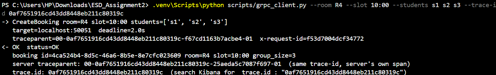
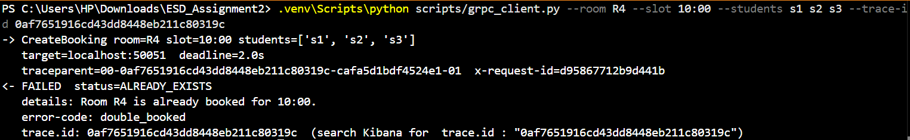
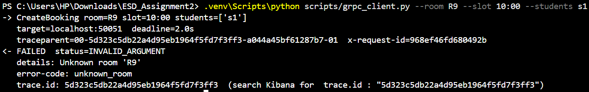
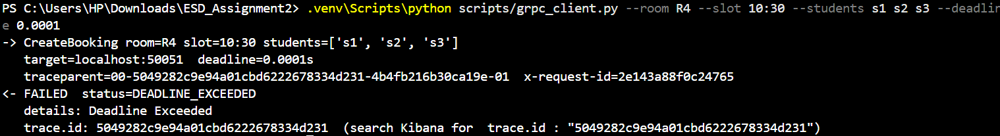

### B.4 Success and failure through both versions

`scripts/compare_http_grpc.py` makes the same calls through both APIs:

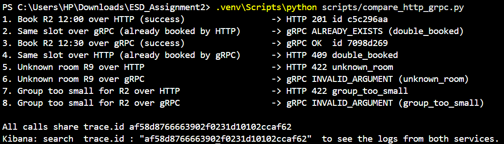

A slot booked over HTTP is refused over gRPC, and a slot booked over gRPC is
refused over HTTP. This shows the shared source of truth. The same bad input is
rejected by both with the same reason code.

| Situation | HTTP status | gRPC status | Why |
|---|---|---|---|
| Booking created | `201 Created` | `OK` | Success. HTTP also says a new resource exists and where (`Location`). |
| Retry with same key | `201` + `Idempotent-Replayed: true` | `OK`, `replayed = true` | The original result is replayed; nothing new is created. |
| Bad input or broken rule | `422` (`400` if the JSON is malformed) | `INVALID_ARGUMENT` | The request is wrong whatever the server's state. |
| Room already booked | `409 Conflict` | `ALREADY_EXISTS` | The thing the client tried to create already exists. |
| Key reused for a different booking | `422` | `FAILED_PRECONDITION` | The request is valid on its own but clashes with state the server holds for that key. |
| Database busy | `503` + `Retry-After: 1` | `UNAVAILABLE` | Temporary; nothing was written, so the caller may retry. |
| Client gave up waiting | client-side timeout | `DEADLINE_EXCEEDED` | Decided by the client. The server may still finish, which is why retries carry an idempotency key. |
| Unexpected bug | `500` | `INTERNAL` | Logged with the request's trace ID. |

HTTP carries the reason in the JSON error body; gRPC carries the same string in
the `error-code` trailing metadata and the message as the status details.

### B.5 Call paths

Both paths end in the same function and the same database file. A table version
is in [docs/a2/call-paths.md](docs/a2/call-paths.md).

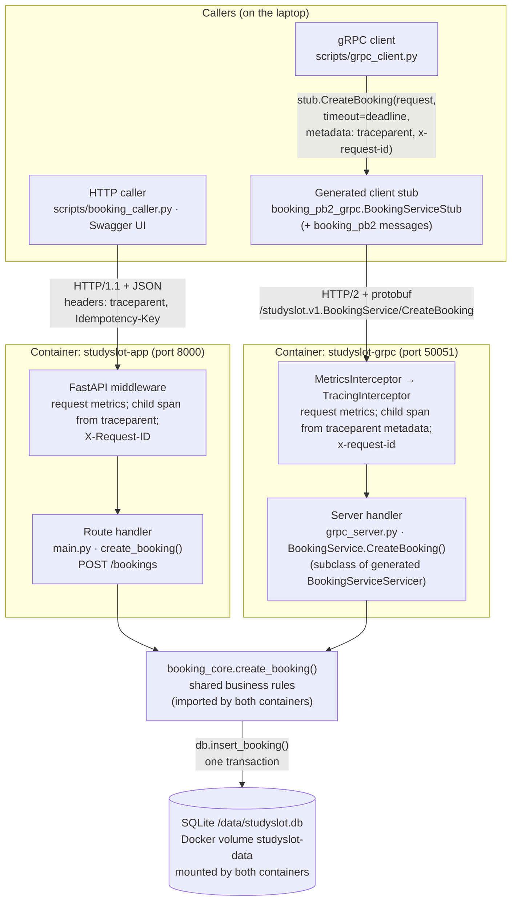

### B.6 Logs and trace correlation across the gRPC boundary

Both services keep A1's JSON logging (shipped by Filebeat to Elasticsearch), and
the gRPC service logs with `service.name = studyslot-grpc`. Correlation follows
the W3C Trace Context format used in the course's Week 1 lab and named in the
lecture (§9):

1. The caller sends `traceparent: 00-<trace-id>-<span-id>-01` as an HTTP header
   or gRPC metadata.
2. Each server keeps the trace-id and starts its own span with the caller's span
   as its parent.
3. Each server logs `trace.id`, `span.id` and `span.parent_id` on every line, and
   returns its own `traceparent` to the caller.

`compare_http_grpc.py` puts all of its calls in one trace, so a single Kibana
search for that `trace.id` returns log lines from both services:

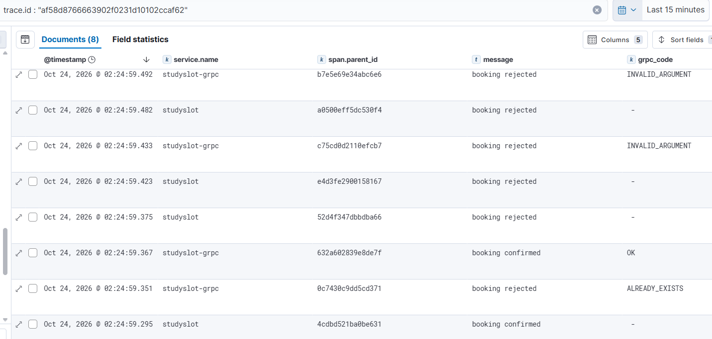

### B.7 Tests

`tests/test_grpc.py` starts the real gRPC server in-process. It checks success,
every error code, idempotent replay, trace propagation (and that the server logs
the caller's trace-id), and shared state with the HTTP API: a gRPC booking is
visible over HTTP, an HTTP booking blocks gRPC, and an HTTP idempotency key
replays over gRPC.

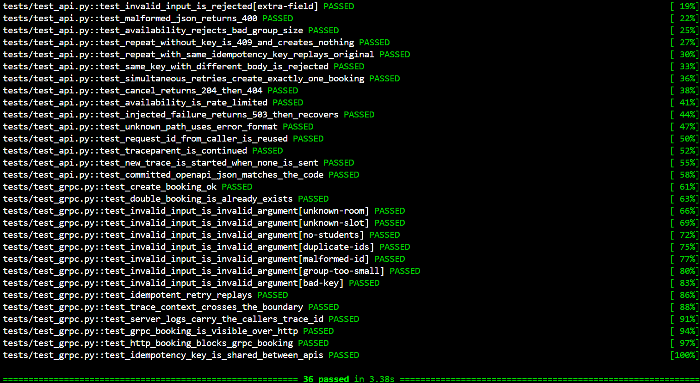

---

## Part C — Metrics

### C.1 Audit of the A1 metrics

| A1 metric | Type | Useful? / problem | Action in A2 |
|---|---|---|---|
| `studyslot_bookings_total` | Counter | Useful business throughput, but only HTTP bookings were counted. | **Fixed:** moved to `metrics.py` and incremented by both APIs (Prometheus `job` tells them apart). Replays are not counted. |
| `studyslot_rooms_occupied` | Gauge | Useful, but A1 added and subtracted in memory, so it was wrong after a restart and blind to gRPC bookings. | **Fixed:** reads the count from the database at every scrape (`set_function`). |
| `studyslot_availability_check_seconds` | Histogram | Kept for the A1 dashboard, but misnamed: it times the whole booking (including the database write), and only for HTTP. | **Kept**; superseded by `http_request_duration_seconds` for request latency. |
| `studyslot_availability_check_summary_seconds` | Summary | Duplicate of the histogram. The Python client's Summary exports no quantiles, and summaries cannot be aggregated across instances. | **Removed.** The A1 "average" panel now uses the histogram's `_sum / _count`. |
| `studyslot_requests_by_id_total` | Counter | Deliberately unsafe (`request_id` label), for the A1 cardinality experiment. | Kept behind its chaos switch (off by default); would be deleted in production. |
| `node_*` | Node Exporter | Useful machine view. | Unchanged. |

**Missing in A1:** request rate, errors and duration per HTTP route (only
bookings were timed); any metrics for the gRPC service; concurrency; and
visibility of idempotent replays.

### C.2 New metrics

All durations are measured **on the server**. Client-side latency, which
includes the network and retries, appears only in the Python callers' output;
they need no Prometheus endpoint. Labels come from small fixed sets only: route
templates such as `/bookings/{booking_id}` (never the real ID), `unmatched` for
unknown paths, known HTTP methods, status codes and RPC names. Tests check that
real IDs never appear in `/metrics`.

| Metric | Purpose | Type | Unit | Labels | Code location | Query used |
|---|---|---|---|---|---|---|
| `http_requests_total` | Calls and errors per route | Counter | requests | `method`, `route`, `status` | `main.py` · `measure_http_requests()` | `sum by (status) (rate(http_requests_total{method="POST",route="/bookings"}[1m]))` |
| `http_request_duration_seconds` | Latency distribution | Histogram | seconds | `method`, `route` | `main.py` · `measure_http_requests()` | `histogram_quantile(0.95, sum by (le) (rate(http_request_duration_seconds_bucket{method="POST",route="/bookings"}[1m])))` |
| `http_requests_in_flight` | Concurrency / saturation | Gauge | requests | `method`, `route` | `main.py` · `measure_http_requests()` | `sum(http_requests_in_flight{method="POST",route="/bookings"})` |
| `grpc_server_handled_total` | Calls and errors per RPC | Counter | RPCs | `grpc_service`, `grpc_method`, `grpc_code` | `grpc_server.py` · `MetricsInterceptor` | `sum by (grpc_code) (rate(grpc_server_handled_total{grpc_method="CreateBooking"}[1m]))` |
| `grpc_server_handling_seconds` | Latency distribution | Histogram | seconds | `grpc_service`, `grpc_method` | `grpc_server.py` · `MetricsInterceptor` | `histogram_quantile(0.95, sum by (le) (rate(grpc_server_handling_seconds_bucket{grpc_method="CreateBooking"}[1m])))` |
| `grpc_server_in_flight_requests` | Concurrency / saturation | Gauge | RPCs | `grpc_service`, `grpc_method` | `grpc_server.py` · `MetricsInterceptor` | `sum(grpc_server_in_flight_requests{grpc_method="CreateBooking"})` |
| `studyslot_idempotent_replays_total` | Retries answered by replay | Counter | requests | none (Prometheus adds `job`) | `metrics.py`; incremented in `main.py` and `grpc_server.py` | `sum by (job) (rate(studyslot_idempotent_replays_total[1m]))` |

Error ratio queries: `sum(rate(http_requests_total{method="POST",route="/bookings",status!~"2.."}[1m])) / sum(rate(http_requests_total{method="POST",route="/bookings"}[1m]))`,
and for gRPC the same with `grpc_code!="OK"`.

**Duration buckets** (same for HTTP and gRPC so they can be compared):
`0.001, 0.0025, 0.005, 0.01, 0.025, 0.05, 0.1, 0.25, 0.5, 1, 2.5, 5` seconds. A
normal booking takes a few milliseconds (one SQLite transaction), so the low end
is fine-grained. The top end covers chaos delays and the caller's 1 s timeout,
so slow calls still land in a real bucket. **p50 and p95 use a 1-minute window**
(`rate(...[1m])`).

**In-flight rather than message size.** Our messages are a handful of short
strings, so a size histogram would be almost flat and say nothing. What changes
under load is how many calls overlap: both servers serialise database writes,
and the gRPC server has 10 worker threads. In-flight shows that saturation
directly. During the traffic burst it rises together with p95, which is queueing
made visible.

**Other missing metric:** `studyslot_idempotent_replays_total`. A replay returns
`201`/`OK`, so no status code reveals that clients are retrying. This counter
does.

### C.3 Prometheus scrapes the gRPC service

The gRPC process serves `/metrics` on its own HTTP port (9101), and
[`monitoring/prometheus/prometheus.yml`](monitoring/prometheus/prometheus.yml)
adds the job `studyslot-grpc` → `studyslot-grpc:9101`.

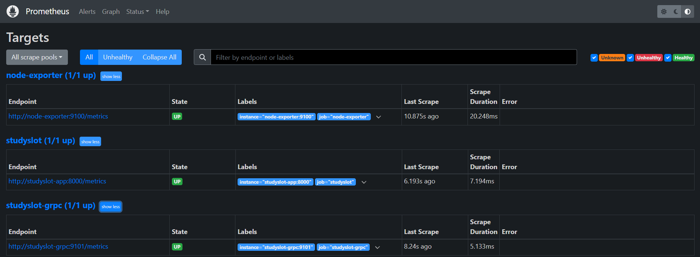

### C.4 Dashboard evidence

The provisioned dashboard **StudySlot A2: HTTP vs gRPC (create booking)**
([JSON](monitoring/grafana/provisioning/dashboards/studyslot-a2-http-vs-grpc.json))
puts HTTP `POST /bookings` on the left and gRPC `CreateBooking` on the right.
It was populated with `scripts/generate_traffic.py`, which runs two phases:

- **Steady (60 s):** 4 workers per API with a 0.2 s pause. Each round books a
  slot, replays the booking with the same key, and every fourth round also sends
  one duplicate and one invalid request. The designed mix is therefore about
  80 % success and 20 % client errors.
- **Burst (30 s):** 12 workers per API with no pause.

Values below are read from the screenshots. All latencies are server side over
a 1-minute window.

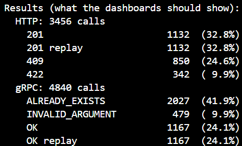

**Calls and error ratio by status.** Both APIs show every expected status:
201 / 409 / 422 over HTTP and OK / ALREADY_EXISTS / INVALID_ARGUMENT over gRPC.
Peak rates were 30.4 req/s (201) and 27.2 req/s (OK). The error ratios were
higher than the designed 20 %: HTTP sat at about 40 % throughout (max 41.4 %),
and gRPC was at 20 % in the steady phase but climbed to 75.9 % in the burst.
The by-status panels show that every extra error was `409` / `ALREADY_EXISTS`,
while `422` / `INVALID_ARGUMENT` stayed at exactly the designed 9.9 %. The cause
is explained in C.5.

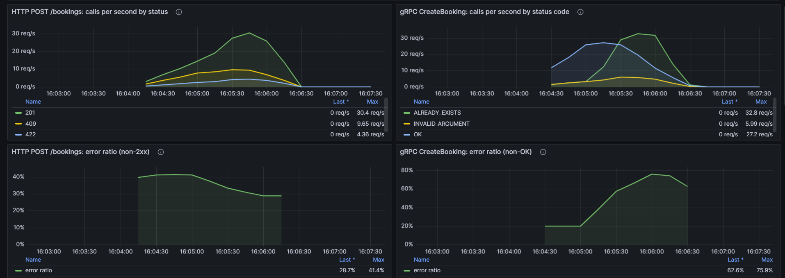

**Latency and duration histograms.**

| | HTTP `POST /bookings` | gRPC `CreateBooking` |
|---|---|---|
| Steady phase: busiest bucket (heatmap) | 50–100 ms | 10–25 ms |
| Steady phase: p95 | ≈ 100 ms | ≈ 40 ms |
| Burst: highest p50 | 92.3 ms | 41.1 ms |
| Burst: highest p95 | 401 ms | 589 ms |

During the burst, p95 rose roughly 4× (HTTP) and 15× (gRPC) while p50 moved
much less. Most calls stayed fast, but a growing tail waited for the database's
single writer, and the heatmaps show calls spreading into the 250 ms – 1 s
buckets. At steady load the HTTP path is slower than gRPC even though both call
the same `booking_core` function. A likely reason is the work around that call:
JSON parsing and validation plus two Starlette middlewares, against decoding one
small protobuf message. Once traffic stopped, p95 shows `NaN` because no calls
were left in the 1-minute window, so no quantile can be computed.

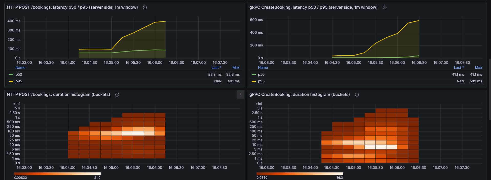

**In-flight, bookings and replays.** In-flight stayed at 0–3 under steady load
and peaked at **8 (HTTP)** and **9 (gRPC)** during the burst, at the same moment
p95 climbed. That is the queueing the in-flight gauge was chosen to expose
(C.2). gRPC stopped at 9 even though 12 clients were calling, because the
server handles at most 10 calls at once (10 worker threads); the rest wait
before the handler starts. Bookings peaked at 15.2/s (HTTP) and 13.6/s (gRPC),
and the replays panel shows identical numbers. That is expected, since every
successful booking was replayed exactly once.

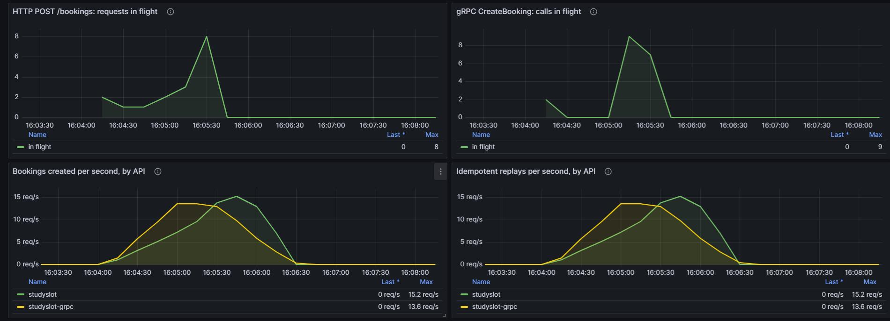

### C.5 What load testing found

**1. SQLite under concurrent writers.** The first burst runs produced
`500`/`INTERNAL` errors: SQLite reported `disk I/O error` and
`database is locked` when both containers wrote heavily at the same time. Three
changes fixed it:

- The database now uses **WAL mode**, which is suited to several processes
  sharing one file.
- Writes inside each process are **queued**, so only the two processes compete
  for SQLite's single write lock.
- A still-busy database now returns a **retryable** `503 storage_busy` /
  `UNAVAILABLE` instead of a crash.

Two repeat runs at a higher load than the script's default then produced no
errors. A single-file database is a limit, and with more load a server database
such as PostgreSQL would be the next step.

**2. The dashboard caught a flaw in the traffic script.** The error-ratio
panels showed the mix was wrong (41 % and 76 % instead of 20 %), and the
by-status panels showed that only "already booked" errors were in excess. The
cause was bookings left behind by earlier demos: R4 10:00 from the Part B client
test, and R5 13:00–15:30 from the Part A caller demo. The script gave some
workers those slots, so those workers never succeeded and, with no pause in the
burst, failed very quickly. That explains why gRPC jumped exactly when the burst
added workers 5–12. Reproducing those leftover bookings with the old script
gave the same skew (22 % `409`, 43 % `ALREADY_EXISTS`). The script now only uses
slots nobody else has booked, and the same test then returned the designed
40 / 40 / 10 / 10 mix, so runs are repeatable whatever the database already
holds.

---

## References and reused work

- Course lecture notes, *APIs: From Local Function Calls to RESTful HTTP Services* (REST constraints, method semantics).
- Course Week 1 lab (Midnight Launch): W3C `traceparent` propagation and HTTP metric naming conventions.
- Assignment 1 (StudySlot) code, extended in this assignment.