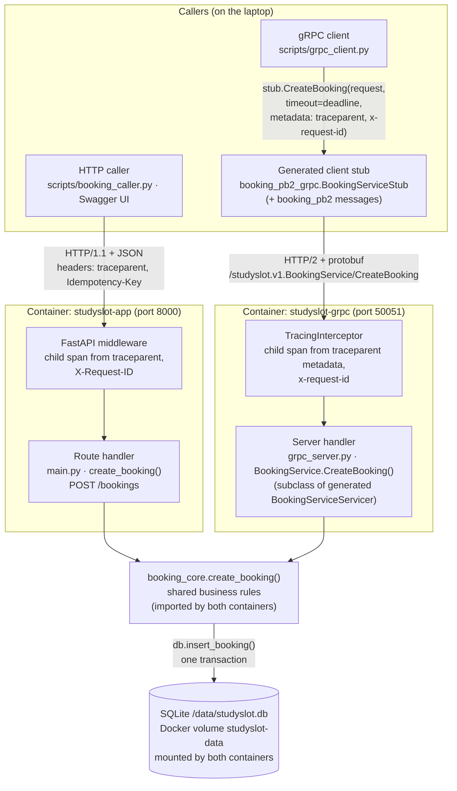

# Call paths: HTTP vs gRPC (Assignment 2, Part B)

Both paths end in the **same** business-rule function and the **same** SQLite
file. The gRPC path is not a wrapper around the HTTP API: it never calls it.

| Step | HTTP path | gRPC path |
|---|---|---|
| Caller code | `booking_caller.py` builds JSON with `httpx` | `grpc_client.py` builds a `CreateBookingRequest` message |
| Client-side generated code | none | `BookingServiceStub` (from `booking_pb2_grpc.py`) serialises to protobuf |
| Transport | HTTP/1.1, JSON body | HTTP/2, protobuf body |
| Trace context (W3C) | `traceparent` header in, `traceparent` header out | `traceparent` metadata in, `traceparent` response metadata out |
| Logged as | `trace.id`, `span.id`, `span.parent_id`, `request_id` | the same fields, `service.name = studyslot-grpc` |
| Server entry | FastAPI middleware → route `create_booking()` in `main.py` | `TracingInterceptor` → `BookingService.CreateBooking()` in `grpc_server.py` |
| Business rules | `booking_core.create_booking()` | `booking_core.create_booking()` (same function) |
| Storage | `db.insert_booking()` → SQLite on volume `studyslot-data` | same function, same file |
| Errors | `BookingError` → HTTP status + JSON error body | `BookingError` → gRPC status code + `error-code` trailing metadata |

**Trace correlation across the boundary.** The caller starts a W3C trace
(`traceparent: 00-<trace-id>-<span-id>-01`, the format used in the course's
Week 1 lab). Each server keeps the trace-id, starts its own span whose parent
is the caller's span, and logs `trace.id`. One Kibana search for that
`trace.id` therefore returns the log lines from both `studyslot` (HTTP) and
`studyslot-grpc`, as produced by `scripts/compare_http_grpc.py`.
